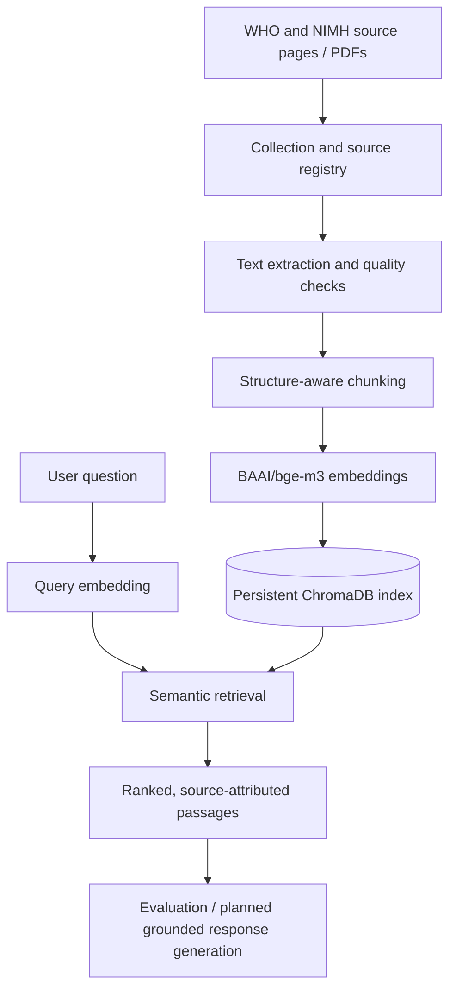

# Evidence-Grounded Anxiety & Stress Support Chatbot (RAG)

A retrieval-augmented generation (RAG) project focused on providing **source-grounded, non-clinical information about anxiety, stress, coping strategies, and help-seeking**. The project builds a traceable knowledge base from authoritative **World Health Organization (WHO)** and **National Institute of Mental Health (NIMH)** resources and evaluates semantic retrieval before integrating a conversational response layer.

> **Project status:** Knowledge-base preparation, embedding/indexing, and retrieval evaluation are the current focus. A complete end-user chatbot and its safety validation should not be assumed to be deployed.
>
> **Important:** This is an academic prototype, not a medical device or a substitute for professional mental-health care. It does not diagnose, treat, or provide emergency services.

## Overview

General-purpose language models may produce plausible answers without clear evidence. This project explores a RAG-based approach that retrieves relevant passages from curated mental-health information sources before generating responses. The goal is to make answers more transparent, auditable, and grounded in accessible references.

**Scope:** Everyday stress, anxiety, excessive worrying, practical coping information, and guidance on when and how to seek support. Clinical manuals and emergency-only references are handled separately from ordinary informational content.

## Technology stack

| Component | Technology |
| --- | --- |
| Language | Python |
| Source collection and parsing | BeautifulSoup, PyMuPDF |
| Embedding model | `BAAI/bge-m3` (via Sentence-Transformers) |
| Vector database | ChromaDB |
| Retrieval | Semantic vector search with source metadata |
| Evaluation | Precision@K, Recall@K, Mean Reciprocal Rank (MRR), Hit Rate |

## System architecture



### 1. Knowledge-base collection and auditing

- Collect information from selected WHO and NIMH HTML pages and PDF publications.
- Maintain a source registry and review links, provenance, and document metadata.
- Check topic coverage and remove irrelevant page boilerplate and repeated text.
- Separate reference-only or clinical content from the core corpus when appropriate.

The corpus is curated for **source quality and relevance**, rather than simply maximizing document volume.

### 2. Structure-aware document chunking

- Preserve meaningful boundaries such as headings, sections, lists, and tables where available.
- Split longer sections into manageable passages using token-aware size and overlap settings.
- Retain document IDs and available section/page metadata for traceability.
- Review extracted chunks before indexing to reduce noise in retrieval results.

### 3. Embeddings and vector indexing

- Generate dense text embeddings using [`BAAI/bge-m3`](https://huggingface.co/BAAI/bge-m3).
- Store vectors and metadata in a persistent ChromaDB collection.
- Use source metadata to support filtering and inspection of retrieved passages.
- Design the indexing workflow for repeatable updates and avoidance of unnecessary re-embedding.

### 4. Retrieval evaluation

The retrieval component is evaluated against a manually reviewed question set with expected relevant source documents. The evaluation examines whether appropriate passages are returned, rather than relying only on similarity scores.

| Metric | What it measures |
| --- | --- |
| Precision@K | Fraction of the top-K results that are relevant |
| Recall@K | Fraction of relevant results found in the top K |
| MRR | How highly the first relevant result ranks |
| Hit Rate@K | Fraction of questions with at least one relevant result in the top K |

Chunk-size experiments help assess the trade-off between contextual completeness and retrieval specificity.

**Evaluation results:** Add verified values from the project's evaluation outputs before publishing quantitative claims.

| Experiment | Questions | MRR | Hit@5 |
| --- | ---: | ---: | ---: |
| Final selected configuration | TBD | TBD | TBD |

> Record the evaluation unit (document-level versus chunk-level relevance), K values, and test-set version alongside the reported scores for reproducibility.

## Repository organization

The exact layout may differ depending on the current repository. An illustrative organization is:

```text
.
├── scripts/
│   ├── chunk_documents.py
│   └── evaluate_retrieval.py
├── rag_knowledge_base/
│   ├── raw_documents/
│   ├── chunks/
│   └── source_registry.csv
├── evaluation/
│   ├── retrieval_test_questions.json
│   └── review_candidates.csv
├── requirements.txt
└── README.md
```

Only retain files and folders in this example that actually exist in your repository. Generated indexes, downloaded documents, and large datasets may be excluded from version control when redistribution is not appropriate.

## Getting started

### Prerequisites

- Python 3.10+ (subject to the versions supported by the repository's dependencies)
- Sufficient memory and disk space to download and run the embedding model

### Installation

```bash
git clone https://github.com/aryanshrivastav25/anxiety-stress-rag
cd https://github.com/aryanshrivastav25/anxiety-stress-rag
python -m venv .venv
source .venv/bin/activate  # Windows: .venv\Scripts\activate
pip install -r requirements.txt
```


### Document processing and evaluation

The following commands are examples from the project's documented workflow. Run them only after preparing the required input files and configuring the paths expected by each script.

```bash
python scripts/chunk_documents.py
python scripts/evaluate_retrieval.py draft-questions
python scripts/evaluate_retrieval.py suggest
```

For evaluation, review the retrieved candidates in `evaluation/review_candidates.csv`, then record the relevant document IDs and review status in `evaluation/retrieval_test_questions.json` as required by the evaluation script.

> **Embedding and indexing:** Add the exact command for the repository's BGE-M3/ChromaDB index-building script here. Do not assume a script name until it is checked against the repository.

## Quality, safety, and limitations

- **Evidence grounding:** The intended response system should connect factual claims to retrieved WHO/NIMH passages.
- **Non-clinical scope:** The system is designed for education and supportive conversation, not medical diagnosis or treatment recommendations.
- **Safety:** Crisis detection, emergency redirection, and response-level safety checks are important requirements for the eventual chatbot and must be tested before deployment.
- **Source limitations:** A curated corpus cannot cover every mental-health situation or replace personalized professional advice.
- **Retrieval limitations:** High retrieval scores alone do not establish that generated answers are safe, accurate, or empathetic.
- **Content rights:** Source attribution and links do not automatically grant permission to redistribute full source documents; review each source's applicable terms.

## Roadmap

- [x] Define the anxiety-and-stress project scope.
- [x] Curate WHO/NIMH resources and prepare source-aware chunks.
- [x] Use BGE-M3 for semantic embeddings and retrieval experiments.
- [x] Prepare and manually review retrieval evaluation questions.
- [ ] Publish verified corpus statistics, evaluation scores, and chunk-size comparisons.
- [ ] Integrate retrieved context into a conversational generation pipeline.
- [ ] Add source citations, refusal boundaries, and crisis escalation behavior.
- [ ] Evaluate response grounding, usefulness, empathy, and safety.
- [ ] Explore a fine-tuned language model combined with RAG (Stage 2).

## References

- [WHO — Mental health](https://www.who.int/health-topics/mental-health)
- [WHO — Doing What Matters in Times of Stress](https://www.who.int/publications/i/item/9789240003927)
- [NIMH — Anxiety Disorders](https://www.nimh.nih.gov/health/topics/anxiety-disorders)
- [NIMH — Caring for Your Mental Health](https://www.nimh.nih.gov/health/topics/caring-for-your-mental-health)
- [BAAI/bge-m3 model](https://huggingface.co/BAAI/bge-m3)
- [Chroma documentation](https://docs.trychroma.com/)

## Project context

Developed as an academic project exploring trustworthy, retrieval-grounded conversational support in the anxiety and stress domain.

**Maintainer:** [Aryan Shrivastav](https://github.com/aryanshrivastav25)

---

*The project is intended for research and educational use. If you or someone else is in immediate danger, contact local emergency services or an appropriate crisis-support service rather than relying on this prototype.*
